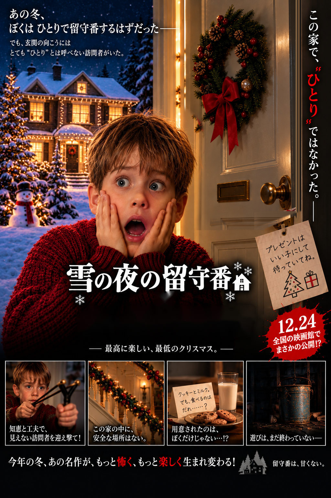

# 動くPDFで作る呪いの絵

1ページのPDFで動くホラーポスターと、画面と印刷で姿が変わる日本人形。動画・GIFの埋め込みやページ送りは使いません。

公開先：[hanglingmu0-web/haunted-pdf](https://github.com/hanglingmu0-web/haunted-pdf)

| 作品 | PDF | 仕掛け |
| --- | --- | --- |
| 雪の夜の留守番 | [ダウンロード](samples/Snow_Night_Visitor.pdf) | 扉が開く。41個の画像付きボタンをJavaScriptで切り替え |
| 髪が伸びる日本人形 | [ダウンロード](samples/ningyo_halloween_pumpkin.pdf) | 髪が伸びる。同じ構造でゆっくり再生 |
| 印刷すると変わる日本人形 | [ダウンロード](samples/Ningyo_Halloween_Poster.pdf) | ページ本体＋印刷専用Stamp注釈。JavaScriptなし |



上の画像は静止画です。仕掛けを体験するにはPDFをダウンロードしてください。GitHubのプレビューは動作確認の代わりにはなりません。

## 開き方

アニメーションはデスクトップ版Adobe Acrobat ReaderのJavaScript環境を想定しています。ただし、このリポジトリの検証ではAcrobat ReaderおよびChromeでの実再生を確認していません。ビューアーと設定によって動かない場合があります。JavaScriptが実行されなくても、ページ本体の静止画像を表示する構造です。

日本人形はゆっくり変化します。コード上は14秒後に最初のボタン画像へ切り替わりますが、この画像は初期画像と同じです。初期画像と画素が異なる画像へ進むのは16秒後です。映画ポスターは4.2秒後に最初のボタン画像へ切り替わり、初期画像と画素が異なる画像へ進むのは9秒後です。タイマーの実行間隔はビューアーの状態に左右されます。

印刷版では、スタンプを含める印刷設定が必要です。Adobeの説明する「Document and Stamps」または「Document and Markups」に相当する設定を確認してください。画面用と印刷用の結果は[プレビュー比較](docs/TECHNICAL.md#印刷版)で確認できます。[Adobeの印刷設定解説](https://helpx.adobe.com/acrobat/desktop/print-documents/use-secure-and-special-print-mode/print-comments.html)

## 収録内容

- `samples/`：作者提供の3点。バイト列を変更せず収録。
- `src/pdf_tools.py`：構造調査、画像抽出、PDF再構築、比較検証。
- `src/original/`：各PDFの有効なJavaScriptを抽出した読み物用ソース。
- `tests/timer.test.cjs`：Acrobat APIを模擬したフレーム順序・タイマー検証。
- [技術解説](docs/TECHNICAL.md)、[検証結果](docs/VALIDATION.md)、[個人情報検査](docs/PRIVACY.md)。
- [note記事の修正案](docs/NOTE_REVIEW.md)、[公開情報・記事用リンク](docs/PUBLICATION.md)。

元の画像制作プロジェクトや元の制作コードは提供されていません。本リポジトリのPythonコードは、提供PDFから画像を抽出して仕組みを再構築したものです。画像そのものをAIで一から生成し直すコードではありません。

## 再構築と検証

Python 3.10以降とNode.jsが必要です。リポジトリ直下で次を実行します。

```sh
python -m venv .venv
# 仮想環境を有効化してから実行
python -m pip install -r requirements.txt
python src/pdf_tools.py inspect
python src/pdf_tools.py extract
python src/pdf_tools.py build
python src/pdf_tools.py validate
node tests/timer.test.cjs
```

抽出物は`work/assets/`、再構築PDFは`work/rebuilt/`、検証結果は`work/validation/`に保存されます。`work/`はGit管理対象外です。

再構築版は元PDFと画像・仕掛けを比較するための別ファイルです。オブジェクト番号、圧縮、メタデータは一致せず、元のContent Credentialsも移植しません。来歴情報を含む原本は`samples/`に保持しています。

## この仕組みで守れないもの

印刷専用の表示は暗号化やアクセス制御ではありません。印刷を禁止することも、画像の抽出や画面の保存を防ぐこともできません。機密情報を隠して配布する手段としては扱わず、演出・印刷用注記・文書検査の教材として説明しています。

収録PDFのスクリプトには、外部送信、URL起動、ローカルファイル取得、外部プログラム起動の処理を確認していません。これは今回の3点の静的検査結果であり、一般のPDFの安全性を保証するものではありません。

## 公開状況と利用条件

このリポジトリは2026年10月21日に公開しました。現時点でPDF・画像・コードのライセンスは指定していません。作品は架空の映画ポスターを含み、公式作品・公式告知ではありません。
